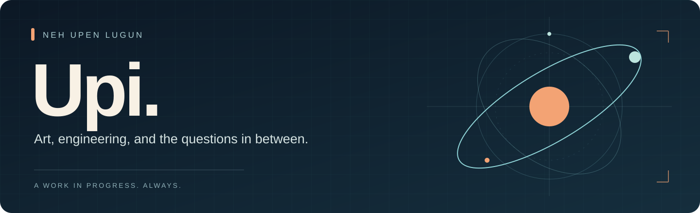

  

  <a href="https://github.com/upitheone/Artworks">ARTWORK</a>
  &nbsp; · &nbsp;
  <a href="https://github.com/upitheone/School-Articles-">WRITING</a>
  &nbsp; · &nbsp;
  <a href="https://github.com/upitheone?tab=repositories">REPOSITORIES</a>

 

## Hi, I'm Upi.

**Artist by instinct. Engineer in the making.**

I'm Neh Upen Lugun. I'm interested in the meeting point between art, engineering, and the way we think. Astronomy makes me look outward; drawing and writing help me make sense of what I find.

This is my space for learning in public, collecting experiments, and turning curiosity into something I can share.

 

### A few places to start

<table>
  <tr>
    <td width="50%" valign="top">
      <h3>01 / Visual thinking</h3>
      
A home for my traditional art and the practice of observing more closely.

      <a href="https://github.com/upitheone/Artworks"><strong>Explore Artworks →</strong></a>
    </td>
    <td width="50%" valign="top">
      <h3>02 / Written thinking</h3>
      
Articles from my school years: personal growth, critical thinking, and finding my place in a larger system.

      <a href="https://github.com/upitheone/School-Articles-"><strong>Read the articles →</strong></a>
    </td>
  </tr>
</table>

 

### Questions that keep me curious

- How can engineering and design help us explore beyond Earth?
- What changes when we use code to explain an idea visually?
- How do the systems around us shape the people we become?

 

> “The system may shape me, but I choose how I evolve in it.”

Observe carefully. Think independently. Keep making.

